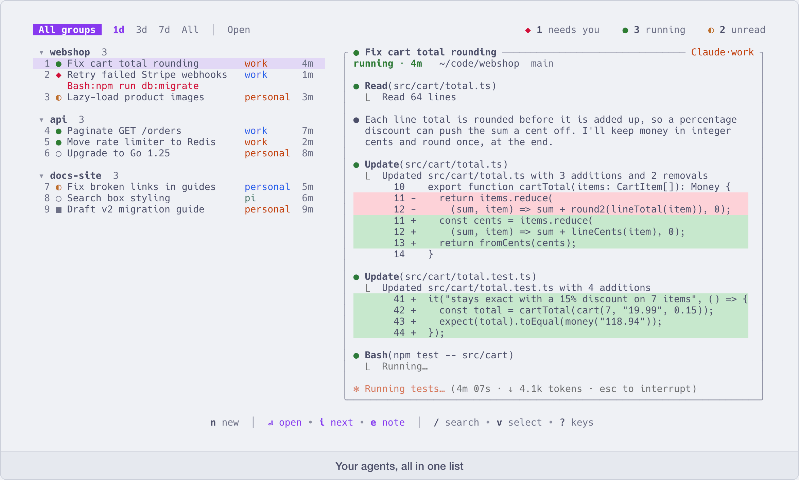

# aca

**One screen for all your AI coding agent sessions** — Claude Code, Codex, pi, opencode, and any other agent you plug in.

English | [简体中文](README.zh-CN.md)



When you run several agents at once, it gets hard to tell which one is still working, which one stopped to
ask you something, and which one finished while you were looking elsewhere. aca puts every session in one
list, shows a live view of the one you select, and takes you into it when you press Enter.

Each session is an ordinary tmux session. If you close aca, the agents keep running, and you can still
reach them with plain tmux, including over SSH from another machine or your phone.

aca is modeled on [agent-deck](https://github.com/asheshgoplani/agent-deck); see [Acknowledgements](#acknowledgements).

## What you get

- **One list with clear states.** `●` working · `◆` needs you · `◐` finished and not read yet ·
  `○` idle · `✕` error · `■` stopped · `☾` stopped by aca after sitting idle (see `[idle]` in
  [Configuration](docs/configuration.md)). → [Keep an eye on many sessions](docs/many-sessions.md)
- **Several accounts side by side.** Personal and work subscriptions, an API key, Bedrock: sessions from
  all of them sit in the same list, and aca makes sure one account's login never leaks into another.
  → [Several accounts, and running out of quota](docs/several-accounts.md)
- **Your agent setup stays yours.** aca does not write hooks or anything else into `~/.claude` or
  `~/.codex`. It passes what it needs on the command line when it starts a session. Logging in is always
  done with the tool's own login command. → [Accounts](docs/accounts.md)
- **Stop and resume in place.** Stop a session and start it later: it resumes the same conversation in
  the same tmux pane. Other windows you opened next to it are left alone. → [Everyday commands](docs/commands.md)
- **Read without going in.** Look at a session's output, its git diff, or a turn-by-turn record of the
  conversation (what it ran, which files it changed, what the turn cost) straight from the list.
  → [Look without going in](docs/look-without-going-in.md)
- **Everything is also a command.** `aca new`, `aca send`, `aca wait`, `aca answer` and the rest do what
  the interface does, so scripts can drive sessions, and one agent can start another, hand it a task and
  be told when it is done. → [Drive sessions from scripts and other agents](docs/scripting.md)
- **Take over sessions that are already running.** A Claude or Codex you started by hand in tmux can be
  brought into the list without stopping it. → [Sessions you started without aca](docs/adopt.md)
- **Usage and cost.** What your local Claude and Codex usage would cost at API prices, plus how much of
  your subscription limits is used. → [Usage, cost and limits](docs/usage-and-cost.md)
- **Plugins.** A plugin is a directory with a manifest. It can add commands, react to events, open panes,
  and give agents skills and MCP servers. A few ship with aca: desktop notifications, delegating work to
  another session, running long jobs on another machine, and more. → [Plugins](docs/plugins.md)
- **No background service.** State is a handful of small files written by the agents' hooks. Nothing runs
  when you are not using it. → [Where aca keeps its files](docs/install.md#where-aca-keeps-its-files)

## Install

```sh
curl -fsSL https://raw.githubusercontent.com/cheny-00/aca/main/install.sh | sh
```

You need:

- macOS or Linux
- [tmux](https://github.com/tmux/tmux) 3.3 or newer
- [Claude Code](https://github.com/anthropics/claude-code), [Codex CLI](https://github.com/openai/codex),
  [pi](https://pi.dev) or [opencode](https://opencode.ai) (any of them), installed and logged in

Other ways to install, the script's options, upgrading and uninstalling: [Install](docs/install.md).

## Quick start

```sh
aca setup                 # optional, see below
aca                       # open the interface
```

1. In the interface, press `n`, pick Claude or Codex, and confirm the directory. A session starts.
2. aca takes you straight into it: talk to the agent as usual.
3. Press `Ctrl+Q` to come back to the list. The agent keeps working. `Enter` on a session goes back in.
4. Start a few more. Watch the marks in the list; `i` jumps to the next session that needs you.
5. Press `?` any time for the keys (the common ones are listed under [Keys](docs/keys.md)).

`aca setup` is one screen where you can register extra accounts and choose whether aca shows Claude's
subscription limits. Nothing is changed until you press Enter, and Esc leaves everything as it was. If you
only use the default `~/.claude` and `~/.codex`, you can skip it.

The interface is in English by default. For Chinese, press `Ctrl+S` then `l` in the interface, or set
`ACA_LANG=zh`.

**New here? [Getting started](docs/onboarding.md) walks through the first fifteen minutes**, including the
two prompts each agent shows the first time and how to make them go away.

## Documentation

**Start here**

- [Getting started](docs/onboarding.md): the first fifteen minutes
- [Install](docs/install.md): every way to install, the install script's options, upgrading, optional tools,
  where aca keeps its files, uninstalling

**Guides**

- [Keep an eye on many sessions](docs/many-sessions.md): know which session needs you and get there in one key
- [Look without going in](docs/look-without-going-in.md): a session's output, its diff and its conversation
  record, straight from the list
- [Several accounts, and running out of quota](docs/several-accounts.md): start under the account you want,
  and carry on under another when one runs out
- [Drive sessions from scripts and other agents](docs/scripting.md): the commands as building blocks, and
  one agent handing work to another
- [Usage, cost and limits](docs/usage-and-cost.md): what your usage would cost, and how much of your
  subscription limits is used

**Reference**

- [Keys](docs/keys.md): the keys in the list, inside a session and from any tmux session, and which ones
  you can change
- [Everyday commands](docs/commands.md): the commands you will use most
- [Configuration](docs/configuration.md): `config.toml`, section by section
- [Accounts](docs/accounts.md): registering accounts, and connecting Claude's status bar to see its limits
- [Sessions you started without aca](docs/adopt.md): adopting running sessions, importing from agent-deck
- [Plugins](docs/plugins.md): using and writing plugins
- [jobhook](https://github.com/cheny-00/jobhook): the small server behind the remote tasks plugin (`aca.remote`),
  a separate project
- `aca help`, `aca help <command>`, `aca help keys`, `aca help config`: the complete reference, always
  matching the version you have installed

**Contributing**

- [Development](docs/development.md): how the code is laid out, running the tests, keeping manual tests
  isolated, publishing a release

## Acknowledgements

aca was built with [agent-deck](https://github.com/asheshgoplani/agent-deck) as its reference. The idea of one terminal screen for all your
agent sessions, each running in its own tmux session, and the way other agents are plugged in, come from
agent-deck. aca is a separate program written in Rust, not a fork of it. Thanks to agent-deck and its
contributors.

## License

[MIT](LICENSE)
