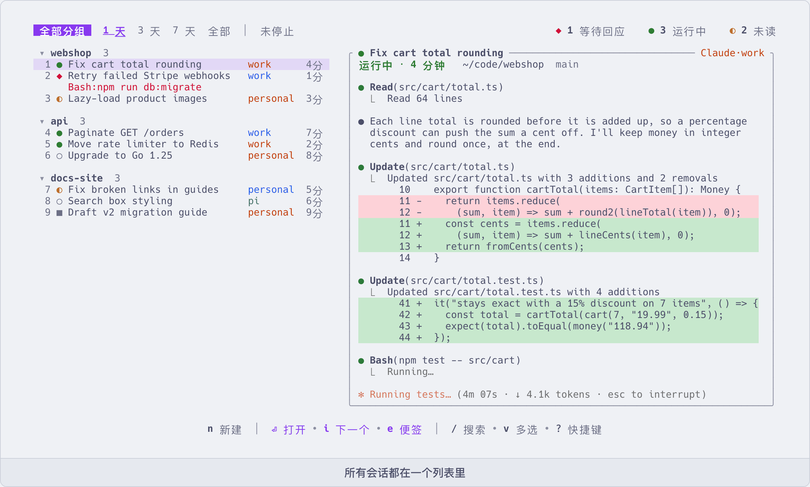

# aca

**在一个屏幕上管理你所有的 AI 编程助手会话** —— Claude Code、Codex、pi、opencode,以及你自己接进来的其他 agent。

[English](README.md) | 简体中文



同时运行好几个 agent 时,很难分清哪个还在工作、哪个在等你回答、哪个已经在你没注意时完成了。
aca 把所有会话放进一个列表,选中哪个就显示它的实时画面,按回车进入。

每个会话都是一个普通的 tmux 会话。关闭 aca 后 agent 照常运行;你也可以直接用 tmux 进入会话,
包括从另一台电脑或手机上通过 SSH 连接。

aca 是参考 [agent-deck](https://github.com/asheshgoplani/agent-deck) 做的,见[致谢](#致谢)。

## 它能做什么

- **一个列表,状态一眼看清。** `●` 运行中 · `◆` 等待回应 · `◐` 未读 · `○` 空闲 · `✕` 出错 · `■` 已停止 · `☾` 自动停止(见[配置](docs/configuration.zh-CN.md)里的 `[idle]`)。
  → [同时盯很多会话](docs/many-sessions.zh-CN.md)
- **多个账号放在一起用。** 个人订阅、公司订阅、API key、Bedrock:所有账号的会话都在同一个列表里,
  而且 aca 保证一个账号的登录不会被另一个账号的会话用到。→ [多个账号,额度用完了怎么办](docs/several-accounts.zh-CN.md)
- **不改动你的 agent 配置。** aca 不会往 `~/.claude` 或 `~/.codex` 里写 hook 或者别的东西。
  它需要的东西是在启动会话时通过命令行参数带进去的。登录永远用工具自己的登录命令。→ [账号](docs/accounts.zh-CN.md)
- **停止后能在原处继续。** 停止一个会话,之后再启动时,它会在同一个 tmux 窗格里继续原来的对话。
  你在会话里另开的窗口不受影响。→ [常用命令](docs/commands.zh-CN.md)
- **不进会话也能看。** 在列表里就能看一个会话的输出、它改了哪些代码(git diff),
  或者按轮次看对话记录(每一轮执行了什么、改了哪些文件、花了多少钱)。→ [不进会话也能看](docs/look-without-going-in.zh-CN.md)
- **界面能做的事,命令行都能做。** `aca new`、`aca send`、`aca wait`、`aca answer` 等命令和界面的功能一一对应,
  所以脚本可以操作会话,一个 agent 也可以启动另一个 agent、给它派任务、在它做完时收到通知。
  → [用命令和脚本驱动会话](docs/scripting.zh-CN.md)
- **接管已经在运行的会话。** 你手动在 tmux 里启动的 Claude 或 Codex,无需停止就能加入列表。
  → [不是用 aca 启动的会话](docs/adopt.zh-CN.md)
- **用量和花费。** 本机的 Claude 和 Codex 用量按 API 价格折算是多少钱,以及订阅额度已经用了多少。
  → [用量、花费和额度](docs/usage-and-cost.zh-CN.md)
- **插件。** 一个插件就是一个目录加一份清单文件,可以添加命令、响应事件、打开窗格,
  还可以给 agent 带上 skill 和 MCP server。aca 自带几个:桌面通知、把任务派给另一个会话、
  把耗时长的任务放到另一台机器上运行,等等。→ [插件](docs/plugins.zh-CN.md)
- **没有后台常驻进程。** 状态就是 agent 的 hook 写下的几个小文件。你不用它的时候,什么都不在运行。
  → [aca 的文件放在哪里](docs/install.zh-CN.md#aca-的文件放在哪里)

## 安装

```sh
curl -fsSL https://raw.githubusercontent.com/cheny-00/aca/main/install.sh | ACA_LANG=zh sh
```

需要:

- macOS 或 Linux
- [tmux](https://github.com/tmux/tmux) 3.3 或更新的版本
- [Claude Code](https://github.com/anthropics/claude-code)、[Codex CLI](https://github.com/openai/codex)、
  [pi](https://pi.dev) 或 [opencode](https://opencode.ai)(有一个就行),已经装好并登录

其他装法、安装脚本的参数、升级和卸载,见[安装](docs/install.zh-CN.md)。

## 快速上手

```sh
aca setup                 # 可以跳过,说明见下
aca                       # 打开界面
```

1. 在界面里按 `n`,选择 Claude 或 Codex,确认目录,会话随即启动。
2. aca 会直接进入这个会话,像平时一样和 agent 对话即可。
3. 按 `Ctrl+Q` 回到列表,agent 继续运行。在列表里选中会话按 `回车` 可以再次进入。
4. 再新建几个会话。留意每个会话前面的状态标记;按 `i` 可以打开下一个待处理的会话。
5. 随时按 `?` 查看快捷键(常用的列在[按键](docs/keys.zh-CN.md)里)。

`aca setup` 是一个设置页面,可以登记额外的账号、选择要不要让 aca 显示 Claude 的订阅额度。
按回车之前不会修改任何内容,按 Esc 直接退出。如果你只用默认的 `~/.claude` 和 `~/.codex`,可以跳过这一步。

界面默认是英文。想用中文:在界面里按 `Ctrl+S` 再按 `l`,或者设置环境变量 `ACA_LANG=zh`。

**第一次用?[上手指南](docs/onboarding.zh-CN.md)带你走完最初的十五分钟**,
包括每个 agent 第一次启动时会问的两个问题,以及怎样让它们以后不再问。

## 文档

**从这里开始**

- [上手指南](docs/onboarding.zh-CN.md):最初的十五分钟
- [安装](docs/install.zh-CN.md):每种装法、安装脚本的参数、升级、可选的工具、aca 的文件放在哪里、卸载

**使用指南**

- [同时盯很多会话](docs/many-sessions.zh-CN.md):知道哪个会话在等你,按一个键就过去
- [不进会话也能看](docs/look-without-going-in.zh-CN.md):在列表里直接看会话的输出、改动和对话记录
- [多个账号,额度用完了怎么办](docs/several-accounts.zh-CN.md):用你想要的账号启动会话,一个账号的额度用完时换另一个继续
- [用命令和脚本驱动会话](docs/scripting.zh-CN.md):用命令和脚本操作会话,以及让一个 agent 把任务派给另一个
- [用量、花费和额度](docs/usage-and-cost.zh-CN.md):你的用量折算是多少钱,订阅额度用了多少

**参考**

- [按键](docs/keys.zh-CN.md):列表里、会话里面、任何 tmux 会话里的按键,以及哪些键可以改
- [常用命令](docs/commands.zh-CN.md):最常用的命令
- [配置](docs/configuration.zh-CN.md):`config.toml` 的每一个配置节
- [账号](docs/accounts.zh-CN.md):登记账号,以及接入 Claude 的状态栏来查看额度
- [不是用 aca 启动的会话](docs/adopt.zh-CN.md):接管正在运行的会话,从 agent-deck 导入
- [插件](docs/plugins.zh-CN.md):使用和编写插件
- [jobhook](https://github.com/cheny-00/jobhook):远程任务插件(`aca.remote`)背后的小型服务端,是一个单独的项目
- `aca help`、`aca help <命令>`、`aca help keys`、`aca help config`:完整的参考,内容始终和你安装的版本一致

**参与开发**

- [开发](docs/development.zh-CN.md):代码的结构、运行测试、隔离手动测试、发布新版本

## 致谢

aca 是参考 [agent-deck](https://github.com/asheshgoplani/agent-deck) 做的:把所有 agent 会话放在一个终端界面里、每个会话跑在自己的 tmux 会话里,
以及接入其他 agent 的方式,都来自 agent-deck。aca 是用 Rust 另外写的独立程序,不是它的分支(fork)。
感谢 agent-deck 和它的贡献者。

## 许可证

[MIT](LICENSE)
