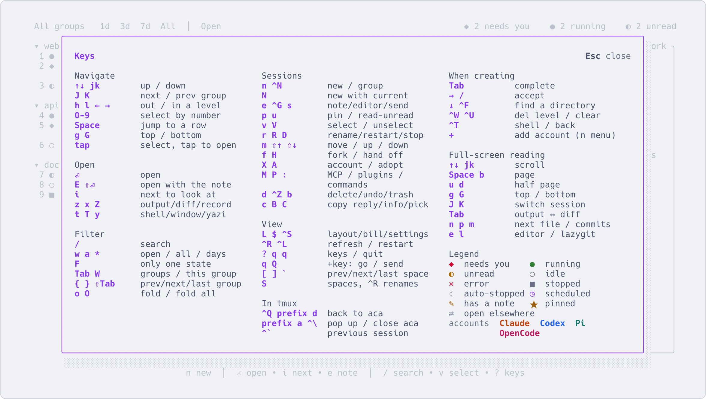

# Keys

English | [简体中文](keys.zh-CN.md)

The keys of the interface: in the list, inside a session, and from any tmux session.

Press `?` in the interface for a one-screen cheat sheet: press any key in it to see what that key does
without doing it. `aca help keys` describes every key in detail.

**In the list**

| Key | What it does |
|---|---|
| `↑` `↓` or `j` `k` | Move. A number jumps to that row |
| `Enter` | Go into the session. A stopped one (`■`) starts again first and resumes its conversation |
| `n` / `N` | New / new with the current settings (same tool, account and directory as the selected session) |
| `i` | Go to the next session waiting for you |
| `Space` | Each row gets a letter; press one to go into that session |
| `/` | Filter the list |
| `z` | Read its output full screen, without going in |
| `x` | What it changed: the git diff of the directory it is working in |
| `Z` | The conversation record, turn by turn: what it ran, what it changed, what each turn cost |
| `e` / `s` | Write a note, the next thing to say to it (on a group: the group's overall thoughts) / send the note |
| `f` | Fork: a new session that continues from this conversation |
| `H` | Hand off: a new session, with any tool or account, picks up where this one is |
| `X` | Carry on under another account, for when this one runs out of quota |
| `r` / `R` / `D` | Rename / restart / stop |
| `d` | Delete; on a group, the group with its sessions. Deleted things stay in the trash for a day; `Ctrl+Z` undoes |
| `b` | Trash: what you deleted in the last day, `⏎` brings it back; `v` selects several to bring back or delete together |
| `m` / `p` | Move to another group / pin to the top |
| `v` `V` | Select several (as in yazi): `v` then move to stretch a range (`Esc` keeps it), `V` stretches one that unselects, `Space` selects one; then `d` `D` `R` `m` `u` `p` `Q` act on all of them, `Ctrl+Z` undoes the batch in one step |
| `Tab` | Pick a group to show, or all of them |
| `$` | Usage and cost |
| `P` / `:` | Plugins / commands: everything aca and your plugins can do to the selected row, each with its key; `/` filters |
| `Ctrl+S` | Settings: theme, language, accounts and logins |
| `Ctrl+L` | Restart the interface in place, for example on a newly installed aca |
| `q` `q` | Quit aca. The sessions keep running. In the tmux popup `Esc` closes it too |

**Inside a session**

| Key | What it does |
|---|---|
| `Ctrl+Q` | Back to the list. The agent keeps working |
| `Ctrl+Alt+N` | Go straight to the next session waiting for you |

Both only apply in sessions that aca started; anywhere else they go to the program as usual. In other tmux
sessions, come back with the tmux prefix and `d`.

**From any tmux session, after `aca tmux install`** (optional, see [Optional tools](install.md#optional-tools))

| Key | What it does |
|---|---|
| `Ctrl+\` | Open aca on the right as a switcher; the session beside it follows the highlight |
| prefix, then `a` | Open aca full screen |

**Changing keys.** The keys in the interface itself are fixed. These can be changed:

- `Ctrl+Alt+N`: `aca tmux key next <key>` with a tmux key name such as `M-n` or `F7`. It is saved as
  `[keys] next` in `config.toml`, and `""` turns it off.
- `Ctrl+\` and prefix + `a` are in `~/.config/aca/tmux.conf`, which aca rewrites when it is upgraded. To use
  other keys, unbind and bind them in your own `tmux.conf` after the line that loads that file.
- `Ctrl+Q`: if you already bound it in tmux yourself, aca leaves your binding alone; use prefix + `d` instead.
- Plugin keys, in the `:` menu and inside sessions: on the plugins page (`P`) or with `aca plugin hotkey`. See
  [docs/plugins.md](plugins.md).
