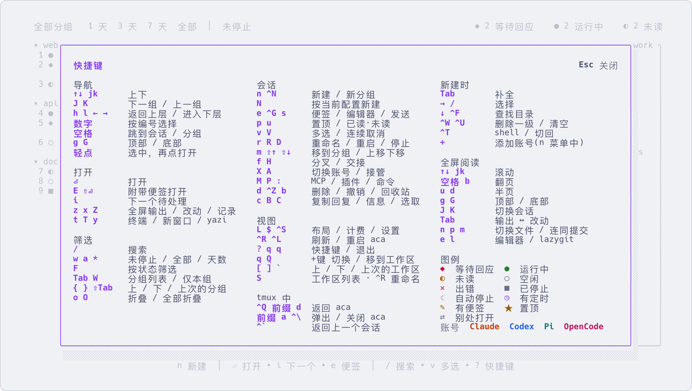

# 按键

[English](keys.md) | 简体中文

界面的按键:在列表里、在会话里面,以及在任何 tmux 会话里。

在界面里按 `?` 打开一屏的快捷键速查表:在速查表里按某个键,会高亮它的说明,但不会执行。`aca help keys` 有每个键的详细说明。

**在列表里**

| 按键 | 作用 |
|---|---|
| `↑` `↓` 或 `j` `k` | 上下移动;按数字直接选中对应编号的会话 |
| `回车` | 进入会话。已停止的(`■`)会先启动,继续原来的对话 |
| `n` / `N` | 新建 / 按当前配置新建(沿用工具、账号和目录) |
| `i` | 打开下一个待处理的会话(`◆` 等待回应或 `◐` 未读) |
| `空格` | 每一行显示一个字母,按对应的字母直接进入 |
| `/` | 过滤列表 |
| `z` | 全屏查看输出,不进入会话 |
| `x` | 查看改动:会话工作目录的 git diff |
| `Z` | 按轮次查看对话记录:执行了什么、改了什么、每一轮的花费 |
| `e` / `s` | 写便签,即准备对它说的下一句话(在分组上写的是整个分组的备注;`Esc` 保存)/ 把便签发送给它 |
| `f` | 分叉:新建一个会话,从当前对话继续 |
| `H` | 交接:新建一个会话(工具、账号可另选),接手它的工作 |
| `X` | 切换账号继续这段对话,用于当前账号额度用完时 |
| `r` / `R` / `D` | 重命名 / 重启 / 停止 |
| `d` | 删除:在分组上会连同其中的会话一起删除。删除的内容在回收站保留 1 天,`Ctrl+Z` 撤销 |
| `b` | 回收站:保留 1 天,`⏎` 恢复;`v` 多选,批量恢复或永久删除 |
| `m` / `p` | 移到分组 / 置顶 |
| `v` `V` | 多选(同 yazi):`v` 后上下移动选中一段(`Esc` 确定),`V` 同样移动但取消选中,`空格` 选中或取消一个;之后按 `d` `D` `R` `m` `u` `p` `Q` 对所有选中的会话执行,`Ctrl+Z` 一步撤销 |
| `Tab` | 分组列表:只看某个分组,或查看全部 |
| `$` | 用量和花费 |
| `P` / `:` | 插件 / 命令:列出 aca 和插件能对选中行执行的操作,每行带直达键,`/` 筛选 |
| `Ctrl+S` | 设置:主题、语言、账号和登录 |
| `Ctrl+L` | 原地重启界面,例如安装新版本之后 |
| `q` `q` | 退出 aca,会话继续运行。在 tmux 弹窗里按 `Esc` 也能关闭 |

**在会话里面**

| 按键 | 作用 |
|---|---|
| `Ctrl+Q` | 回到列表,agent 继续运行 |
| `Ctrl+Alt+N` | 直接进入下一个待处理的会话 |

这两个键只在 aca 启动的会话里有效,在其他地方会照常传给里面的程序。在其他 tmux 会话里,用 tmux 前缀键加 `d` 返回。

**在任何 tmux 会话里,运行过 `aca tmux install` 之后**(可选,见[可选的工具](install.zh-CN.md#可选的工具))

| 按键 | 作用 |
|---|---|
| `Ctrl+\` | 在右侧打开 aca 作为切换器;高亮移到哪个会话,旁边就切换到哪个 |
| 前缀键,再按 `a` | 全屏打开 aca |

**改键。** 界面里的键是固定的,不能改。下面这些可以改:

- `Ctrl+Alt+N`:`aca tmux key next <键>`,键名用 tmux 的写法,比如 `M-n`、`F7`。它记在 `config.toml` 的
  `[keys] next` 里,设为 `""` 表示不绑定。
- `Ctrl+\` 和前缀键 + `a` 写在 `~/.config/aca/tmux.conf` 里,升级 aca 时这份文件会被重写。想换成别的键,
  在你自己的 `tmux.conf` 里、加载这份文件的那一行后面 unbind / bind。
- `Ctrl+Q`:如果你自己在 tmux 里绑定过它,aca 不会修改你的设置;这时用前缀键 + `d` 返回。
- 插件的键(`:` 菜单里的和会话里面的):在插件页(`P`)里改,或者用 `aca plugin hotkey`。见
  [docs/plugins.zh-CN.md](plugins.zh-CN.md)。
