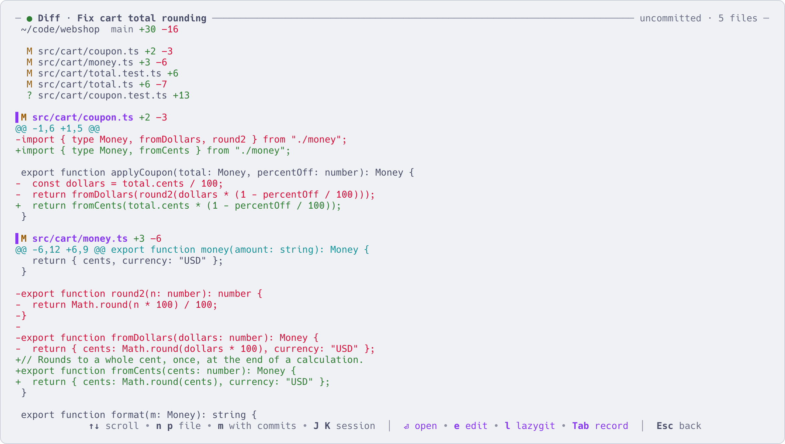
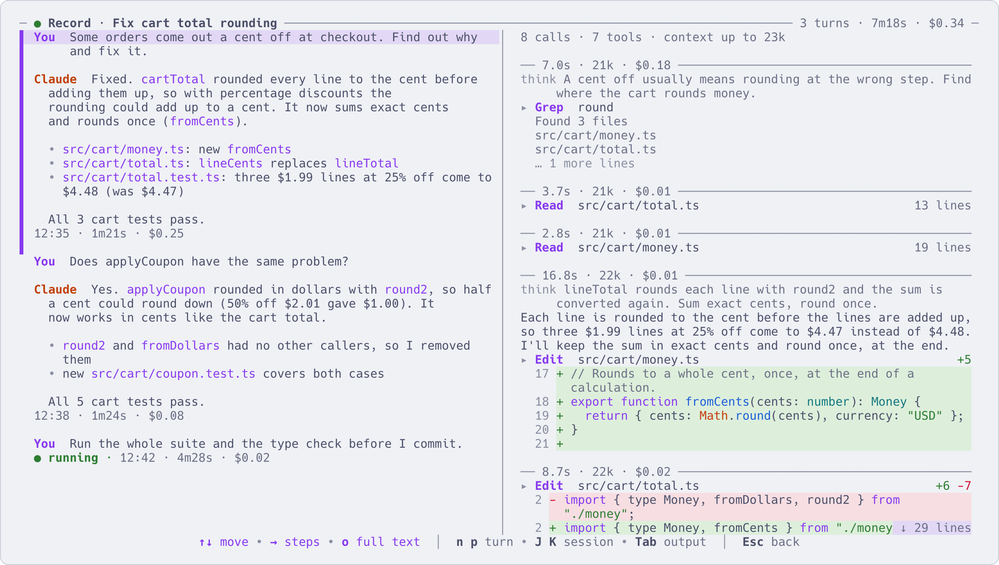

# Look without going in

English | [简体中文](look-without-going-in.zh-CN.md)

Going into a session just to check on it breaks your flow, and it is easy to type into the wrong one. These
keys show you, straight from the list, what a session printed, what it changed and what each turn cost.

The preview on the right of the list already shows the live screen of the highlighted session. Above it:
its state, how long ago it last did something, how many files it changed, its directory and branch.

## The keys

| Key | What you see |
|---|---|
| `z` | Its output, full screen, with all the history you can scroll back through |
| `x` | What it changed: the git diff of the repository it is working in |
| `Z` | The conversation record, turn by turn: what it ran, what it changed, what each turn cost |
| `y` | [yazi](https://github.com/sxyazi/yazi), a file manager, in the directory it is working in |
| `t` | A shell in the lower half of the interface, in that directory |

The first three are linked. On any of them, `Tab` goes on to the next (output → diff → record → output),
`J` / `K` switch to the next / previous session, and `Esc` comes back to the list. On the output and the
diff, `Enter` goes into the session.

## `z`: the output

| Key | What it does |
|---|---|
| `↑` `↓` or `j` `k` | Scroll |
| `Space` / `b` | Page down / up |
| `u` / `d` | Half a page up / down |
| `g` / `G` | Top / bottom |
| `c` | Copy its last reply |

The mouse wheel over the preview scrolls back too; `z` takes you further.

## `x`: what it changed



It shows the repository the session is really working in: it follows the agent when it `cd`s or moves into
a worktree, and says so at the top when that differs from the directory the session was started in. The
file list is on top.

| Key | What it does |
|---|---|
| `n` / `p` | Next / previous file |
| `m` | Include its commits: the diff against where the branch left the main branch. `m` again: uncommitted changes only (the default, new files included) |
| `e` | Open the file at the top of the screen in `$EDITOR`, at that line |
| `l` | Open [lazygit](https://github.com/jesseduffield/lazygit) in that repository. aca reads the diff again when you quit it |

The page refreshes every 2 seconds and only reads: it never stages anything. It needs `git`.

## `Z`: the conversation record



The header gives the whole conversation: number of turns, total time, total cost. On the left, one block
per turn: what you said, the agent's last reply, and `12:20 · 14.5s · $0.04` (when it started, how long it
took, what it cost at API prices). On the right, the steps of the selected turn: each call with its context
size and cost, each command it ran with the start of the output, each edit as red and green lines.

| Key | What it does |
|---|---|
| `↑` `↓` | Move between turns (on the right: between steps) |
| `n` / `p` | Next / previous turn |
| `o` | Show a long message in full |
| `→` | Into the steps on the right. There `o` expands a step (the whole command and output, the full diff), `O` the whole turn |
| `Enter` | On a step: show it full screen, with the token breakdown and the tool's input |
| `←` / `Esc` | Back from the steps to the turns |
| `e` | Open the selected item in `$EDITOR`, read-only. A file the agent read or edited opens at that line |

A step that started a subagent shows what the subagent did and its last words; `Enter` opens the
subagent's own record in the same two panes. Its cost counts toward the turn that started it. While the
session is running, the record keeps growing.

It reads the agent's own conversation files: Claude Code, and Codex from version 0.107.

## `y` and `t`: files and a shell

`y` opens yazi in the session's directory (for a stopped session, the directory it recorded). Quit yazi
with `q` and you are back in aca. yazi is optional; install it yourself.

`t` opens a temporary shell in the lower half of the interface, in the session's directory; a `claude` or
`codex` you run there uses the session's account. Every key goes to the shell. `Esc` hides it and it keeps running; `t` on
the same row brings it back; `exit` closes it.

## From the command line

```sh
aca show 3f2a          # state, directory, conversation id and its last reply
aca output 3f2a        # only its last reply
aca show 3f2a --json   # the same, for scripts
```

## More

- [Keys](keys.md): every key, including the rest of these pages
- [Everyday commands](commands.md): `aca show`, `aca output` and the others
- [Install](install.md): the optional tools (git, yazi, lazygit) and what each one adds
- `aca help keys`
