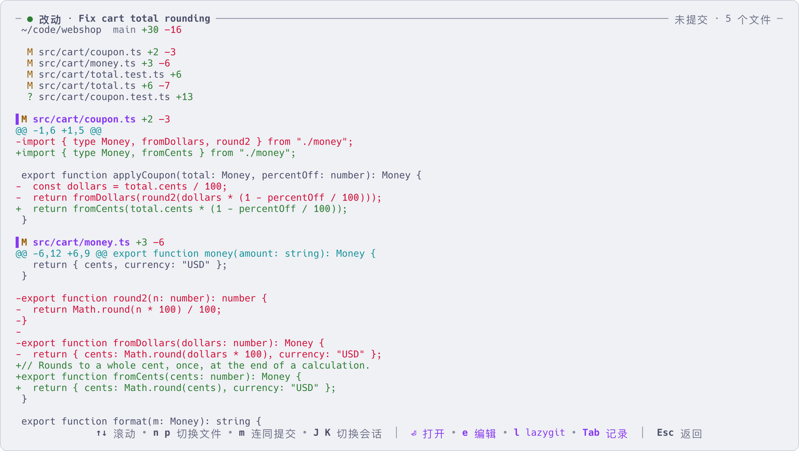
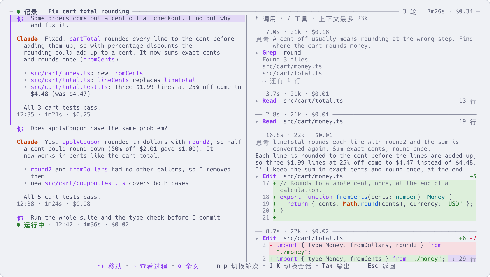

# 不进会话也能看

[English](look-without-going-in.md) | 简体中文

只是想看一眼就进会话,会打断手上的事,还容易在错的会话里打字。下面这些键让你在列表里直接看到
一个会话输出了什么、改了什么、每一轮花了多少钱。

列表右边的预览本来就是高亮会话的实时画面。预览顶部写着:状态、多久以前有过动静、改了几个文件、目录和分支。

## 这几个键

| 按键 | 看到什么 |
|---|---|
| `z` | 全屏阅读它的输出,可以往上翻看全部历史 |
| `x` | 它改了什么:它实际工作的那个仓库的 git diff |
| `Z` | 按轮次看对话记录:执行了什么、改了什么、每一轮花了多少 |
| `y` | 在它实际工作的目录里打开文件管理器 [yazi](https://github.com/sxyazi/yazi) |
| `t` | 在界面下半屏、那个目录里打开一个 shell |

前三个是连在一起的。在任何一页按 `Tab` 切到下一页(输出 → 改动 → 记录 → 输出),
`J` / `K` 切换到下一个 / 上一个会话,`Esc` 回到列表。在输出页和改动页按 `回车` 进入会话。

## `z`:输出

| 按键 | 作用 |
|---|---|
| `↑` `↓` 或 `j` `k` | 滚动 |
| `空格` / `b` | 向下 / 向上翻一页 |
| `u` / `d` | 向上 / 向下翻半页 |
| `g` / `G` | 顶部 / 底部 |
| `c` | 复制它最后一条回复 |

在预览上滚动鼠标滚轮也能往上翻;按 `z` 能翻得更远。

## `x`:改了什么



显示的是会话实际工作的那个仓库:agent `cd` 到别处、进入 worktree,它都会跟过去;
和启动会话时登记的目录不同时,页面顶部会注明。文件列表在最上面。

| 按键 | 作用 |
|---|---|
| `n` / `p` | 下一个 / 上一个文件 |
| `m` | 连同提交:与分支从主干分出的那一点对比。再按 `m`:只看未提交的改动(默认,包括新文件) |
| `e` | 用 `$EDITOR` 打开屏幕顶部那个文件,定位到那一行 |
| `l` | 在这个仓库里打开 [lazygit](https://github.com/jesseduffield/lazygit)。退出 lazygit 后 aca 重新读取改动 |

这一页每 2 秒刷新一次,只读:不会暂存任何东西。需要 `git`。

## `Z`:对话记录



页面顶部是整段对话的汇总:几轮、总耗时、总花费。左边每一轮一块:你说的话、agent 最后的回复,
以及 `12:20 · 14.5s · $0.04`(开始的时间、耗时、按 API 价格折算的费用)。右边是选中那一轮的中间过程:
每次调用的上下文大小和费用,执行的每条命令和输出的开头,每处修改的红绿行。

| 按键 | 作用 |
|---|---|
| `↑` `↓` | 在各轮之间移动(在右边:在各步之间移动) |
| `n` / `p` | 下一轮 / 上一轮 |
| `o` | 长内容看全文 |
| `→` | 进入右边的过程。在那里 `o` 展开一步(完整的命令和输出、完整的改动),`O` 展开这一轮全部 |
| `回车` | 在某一步上:全屏查看这一步,有 token 明细和工具的输入 |
| `←` / `Esc` | 从过程回到左边的对话 |
| `e` | 用 `$EDITOR` 以只读方式打开选中的内容。agent 读过或改过的文件,定位到那一行打开 |

启动了子代理的那一步会显示子代理做了什么、最后说了什么;按 `回车` 用同样的两栏查看子代理自己的记录。
子代理的费用计入启动它的那一轮。会话还在运行时,记录会继续增长。

它读取的是 agent 自己的对话文件:Claude Code,以及 0.107 起的 Codex。

## `y` 和 `t`:文件和 shell

`y` 在会话的目录里打开 yazi(已停止的会话用它记录下的目录)。在 yazi 里按 `q` 退出,就回到 aca。
yazi 是可选的,需要自己安装。

`t` 在界面下半屏打开一个临时 shell,目录是会话的目录;在里面运行 `claude` 或 `codex`,用的是会话的账号。
所有按键都发给这个 shell。
`Esc` 收起,shell 继续运行;在同一行再按 `t` 回来;在里面 `exit` 才关闭。

## 用命令查看

```sh
aca show 3f2a          # 状态、目录、对话 id 和它最后的回复
aca output 3f2a        # 只要它最后的回复
aca show 3f2a --json   # 同样的内容,给脚本用
```

## 更多

- [按键](keys.zh-CN.md):每一个键,包括这几页里其余的键
- [常用命令](commands.zh-CN.md):`aca show`、`aca output` 等命令
- [安装](install.zh-CN.md):可选的工具(git、yazi、lazygit)以及每个工具带来的功能
- `aca help keys`
