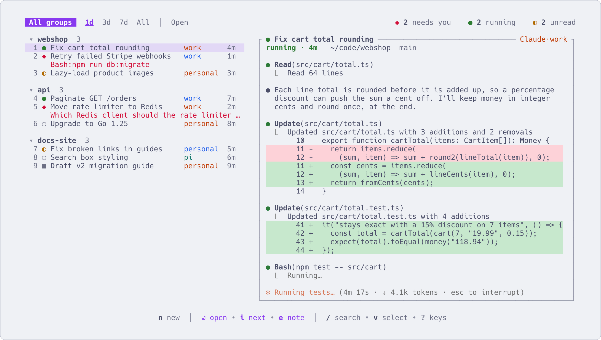

# Keep an eye on many sessions

English | [简体中文](many-sessions.zh-CN.md)

With five agents running, the hard part is knowing which one needs you right now. This page shows how aca
tells you, how to get to that session in one key, and how to be told when you are looking elsewhere.



## Read the marks

The mark in front of each session says what it wants from you. The top bar counts them for the sessions
on screen, for example `◆ 1 needs you   ● 1 running   ◐ 1 unread`.

| Mark | Meaning | What it asks of you |
|---|---|---|
| `◆` | Needs you: a question or a permission prompt. The question shows on a second line under the row | Answer it. The agent is stuck until you do |
| `◐` | Unread: it finished a turn and you have not looked yet | Read the result, give it the next step |
| `●` | Working | Nothing |
| `○` | Idle, and you have seen its last reply | Nothing |
| `✕` | Something went wrong | Go in and look |
| `■` | Stopped | `Enter` starts it again and resumes the conversation |
| `☾` | Stopped by aca after sitting idle (see [below](#stop-the-ones-sitting-idle)) | The same: `Enter` resumes it |

After the title you may also see `✎` (it has a note), and `◷ 12:27` (a message or wakeup is scheduled for it).

## Go to the next one that needs you

| Key | What happens |
|---|---|
| `i` | Goes into the most recent session waiting for you (`◆` or `◐`). Come back with `Ctrl+Q` and press `i` again for the next. Ones you have seen, with no new output since, are skipped |
| `Ctrl+Alt+N` | Inside a session: go straight to the next one waiting, without the list. `◆` comes before `◐` |
| `Space` | Every row gets a letter. Press one to go into that session (on a group, the highlight lands there). `Esc` cancels |
| `u` | On `◐`: mark it read. On `○`: mark it unread again |

`Ctrl+Alt+N` only works in sessions aca started; elsewhere the key goes to the program as usual. Typed, it is
`aca next`. To use another key: `aca tmux key next M-n` (any tmux key name).

## Sort them into groups

Put each project in its own group. A new session goes into the group of the session you had selected.

| Key | What it does |
|---|---|
| `m` | Move the session to another group. Type a name that does not exist to create it |
| `Ctrl+N` | New group: name it, pick its directory, and start the first session in it |
| `Tab` | The group list. Press the letter in front of a group to show only that group, `Space` for all |
| `{` `}` | Previous / next group |
| `W` | Only the highlighted session's group; `W` again for all |
| `p` | Pin to the top, in its own "★ Pinned" block. `p` again unpins |
| `o` / `O` | Fold or unfold the current group / all groups. A folded group is one line, marked `◆` if anything inside needs you |

On the command line, `aca new claude . -g work` starts a session in the group `work` (created if missing),
and `aca move <id> work` moves one.

## Show only what matters

| Key | What it does |
|---|---|
| `/` | Filter by text. `Esc` clears it |
| `F` | Only one state: a small list of states with how many of each. `@` in it is `◆` and `◐` together |
| `!` `@` `#` `&` `^` `%` | The same states straight from the list: running, needs you / unread, idle, error, stopped, auto-stopped. Again to cancel |
| `w` | Only open sessions (everything but stopped). `w` again goes back |
| `*` / `a` | Recent days: 1, 3 or 7 / all of them |

## Leave yourself a note

When you see what a session needs but cannot deal with it yet, write it down.

| Key | What it does |
|---|---|
| `e` | Write a note: the next thing you want to say to it. Saved as you type; `Esc` finishes. The row shows `✎` |
| `E` | Go in with the note typed into its input box, not sent, so you can edit it first |
| `s` | Send the note without going in (asks first, `y` sends). The note is deleted once sent |

On a group, `e` writes the group's own note, for overall thoughts. It is never sent anywhere.

## Get told when you are elsewhere

The bundled `aca.notify` plugin shows a desktop notification when a session finishes a turn, starts waiting
for you, or fails. It stays quiet for the session you are in. It needs `jq`.

```sh
aca plugin install aca.notify         # or press P and pick it under "Available"
aca plugin run aca.notify.test        # shows a test notification
aca plugin setting aca.notify workers true    # also for sessions other agents dispatched
```

Its other settings are `attached` (notify even while you are in that session) and `command` (show
notifications with your own script). `aca.bark` and `aca.discord` send the same to your phone or a Discord
channel; see [First-party plugins](plugins.md#first-party-plugins).

## Watch from inside tmux

```sh
aca tmux install
```

This adds two lines to your `tmux.conf` (`aca tmux uninstall` removes them) and gives you:

- **A count in the tmux status line**, like ` ◆ 2  ◐ 3`: how many need you and how many are unread.
- **`Ctrl+\`** from any tmux session: aca opens on the right as a switcher, and the pane beside it follows the
  highlight. `Enter` stays on that session, `Esc` goes back to where you were, `Ctrl+\` closes it. On a
  window narrower than 120 columns it opens full screen.
- **Prefix, then `a`**: aca full screen.

## Stop the ones sitting idle

An idle agent still uses CPU. Add this to `~/.config/aca/config.toml`:

```toml
[idle]
stop_after = "3h"       # stop sessions idle this long; they show ☾
remove_after = "30d"    # delete sessions stopped this long (into the trash)
```

While the interface is open, aca checks every 5 minutes. It leaves alone any session that is in the middle
of a turn, waiting for you, unread, attached, or has unsent text in its input box or something scheduled
(the full list is in `aca help stop`). `Enter` on a `☾` session resumes its conversation. Deleted ones stay in the trash for a day (`b`, or
`Ctrl+Z` right away); pinned sessions and sessions with a note are never deleted. `aca stop --idle 3h` does
the same once, by hand.

## More

- [Keys](keys.md): every key in the list
- [Configuration](configuration.md): `[idle]`, `[keys]` and the rest of `config.toml`
- [Plugins](plugins.md): notification plugins and what else plugins can do
- `aca help keys`, `aca help next`, `aca help tmux`, `aca help stop`
