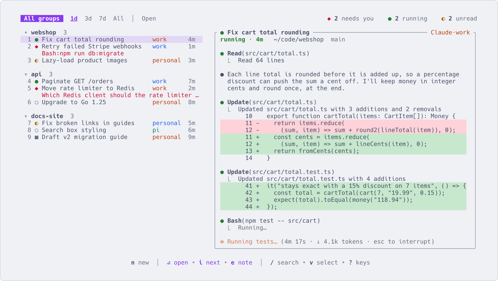

# Keep an eye on many sessions

English | [简体中文](many-sessions.zh-CN.md)

With five agents running, the hard part is knowing which one needs you right now. This page shows how aca
tells you, how to get to that session in one key, and how to be told when you are looking elsewhere.



## Read the marks

The mark in front of each session says what it wants from you. The top bar counts them for the sessions
in the list, for example `◆ 1 needs you   ● 1 running   ◐ 1 unread`.

| Mark | Meaning | What it asks of you |
|---|---|---|
| `◆` | Needs you: a question or a permission prompt. The question shows on a second line under the row | Answer it: go in, or press `s` to answer from the list. The agent is stuck until you do |
| `◐` | Unread: it finished a turn and you have not looked yet | Read the result, give it the next step |
| `●` | Working | Nothing |
| `○` | Idle, and you have seen its last reply | Nothing |
| `✕` | Something went wrong | Go in and look |
| `■` | Stopped | `Enter` starts it again and resumes the conversation |
| `☾` | Stopped by aca after sitting idle (see [below](#stop-the-ones-sitting-idle)) | The same: `Enter` resumes it |

After the title you may also see `✎` (it has a draft), and `◷ 12:27` (a message or wakeup is scheduled for it).

## Go to the next one that needs you

| Key | What happens |
|---|---|
| `i` | Goes into the next session waiting for you: `◆` before `◐`, the most recently active first. Come back with `Ctrl+Q` and press `i` again for the next. Ones you have seen, with no new output since, are skipped |
| `Ctrl+Alt+N` | Inside a session: go straight to the next one waiting, without the list. `◆` comes before `◐` |
| `Space` | Every session on screen gets a letter: press one to go into that session. Every group gets a capital letter of its own, before its name on the rail (on its heading when the screen has no rail): `Shift` + that letter goes into the group, on the row you left it on. A group keeps its letter whatever the list shows. `Space` or `Esc` cancels |
| `a` | From inside a group or from the rail: to all groups, with those letters showing. `a` again goes back to the group and row you were on |
| `u` | On `◐`: mark it read. On `○`: mark it unread again |

`Ctrl+Alt+N` only works in sessions aca started; elsewhere the key goes to the program as usual. Typed, it is
`aca next`. To use another key: `aca tmux key next M-n` (any tmux key name).

## Sort them into groups

Put each project in its own group. A new session goes into the group of the session you had selected.

| Key | What it does |
|---|---|
| `m` | Move the session to another group. Type a name that does not exist to create it under the session's group, with a directory of its own (`Tab` changes the directory first; `/name` creates it at the top) |
| `Ctrl+N` | New group: name it, pick its directory, and start the first session in it |
| `J` `K` | Next / previous group |
| `W` | Into the highlighted session's group; `W` again goes back to all groups |
| `p` | Pin to the top, in its own "★ Pinned" block. `p` again unpins |
| `h` | Onto the rail down the left: one row per group, saying how many `◆` `◐` `✕` `●` it holds and how many sessions. `j` `k` go to the next group and the list follows; `Enter` goes in. A screen under 130 columns keeps no rail: `h` lays it over the left, and `Esc` puts it away |

On the command line, `aca new claude . -g work` starts a session in the group `work` (created if missing),
and `aca move <id> work` moves one.

## Let one session dispatch for you

Once a group holds many sessions, one of them can do nothing but dispatch: the group's router. You tell it something,
it hands that to the session that fits, or starts one when none does; sessions in other groups that you say belong
here, it pulls over. When a router passes on a request during a turn you opened, aca includes your words the first time it contacts
each worker. Long quotes keep the first 1500 characters and give the original length. The worker can decide
how to do the job with your instructions in front of it.

| Key | What it does |
|---|---|
| `o` | On a group's row (on the rail, or its heading): into its router. With none yet, opens a form in the group's directory. Use `↑` to choose a Claude or Codex tool and account, then `Enter` to start it. Claude accounts bound to an SSH sandbox are unavailable. On a session's row: the router of the group it is in |
| `s` | On a group's row: say something to the router without going in |
| `` ` `` | The cursor onto the rail with the groups' letters showing: a letter stops on that group's row, its router's exchange beside it; then `o` or `s` |

A group with a router has an `@` before its name, in the color of the router's state. With the cursor on the group,
the exchange with it is beside the list: what you said, what it answered, whom it handed what, which sessions it
pulled over. A worker's reply (first line), question, error, and ticket completion result appear here too.
New entries are bold.

A Claude router gets aca's dispatch tools and can ask you a question. It has no Bash. Its rules come from the
project router or desk role file. It skips the project's CLAUDE.md and memory. A shift ends after
`[router] idle` (default one hour) when the interface checks, or when a message arrives after that limit.
A router waiting for an answer or with someone attached stays up. A gray `@` means stopped. Press `s` on
the group to send a message and wake it, or `o` to open it. Every start opens a fresh conversation under the same
session ID. The first message is aca's handoff with the current tickets, sessions, recent exchange and pending mail.

A Codex router still gets its rules in its opening message. It stays up when idle, holds or queues incoming
messages while stopped, and resumes its saved conversation when you start it with `o`.

To name an existing session the router: `aca group router <GROUP> <id>`; to name nobody: `aca group router <GROUP> ''`.

What belongs to no project has a place of its own: set a scratch directory with `s` in `Ctrl+S`, and the group that
works there comes right after All; a session started with no project under the cursor goes into it. A `⌂` leads its
name, and the groups under it are written `⌂/name`. That group's
router is the desk: hand it what you don't know whom to give to, and it passes it to the right session or to a
project's router. The Claude desk opens a ticket in the scratch group for work that belongs to no project. Its `@` leads the rail's All row; `o` and `s` on that row
open it and say something to it (with no desk yet `o` starts one, asking for the scratch directory first when none is
set).

## Show only what matters

| Key | What it does |
|---|---|
| `/` | Filter by text; the highlight goes to the match with the most recent activity (open ones first). `Esc` clears it |
| `F` | Only one state: a small list of states with how many of each. `2` in it is `◆` and `◐` together; `☾` auto-stopped is a part of `■` stopped |
| `F` then `1`–`6` | Pick one straight away: running, needs you / unread, idle, error, stopped, auto-stopped |
| `0` | Every session, however long ago it stopped (`F` then `0` too). `0` again or `Esc` goes back |
| `w` | Switch between open sessions (the default) and the last 7 days (stopped ones too) |

## Leave yourself a draft

When you see what a session needs but cannot deal with it yet, write it down.

| Key | What it does |
|---|---|
| `e` | Write a draft: the next thing you want to say to it. Saved as you type; `Esc` finishes. The row shows `✎` |
| `E` | Go in with the draft typed into its input box, not sent, so you can edit it first |
| `s` | Reply without going in: the draft is already in the box, `Enter` sends it, `Ctrl+J` is a newline, `Esc` keeps it. The draft is deleted once sent |

On a group, `e` writes a note in the group's notebook instead, for overall thoughts (`Tab` inside the group lists them). Notes are never sent anywhere.

What you hand a session to do can be kept as a task ticket: inside the group `Tab` to its tasks page, `n` makes one (a
title and what counts as done), `m` hands it to one of the group's sessions, which is sent the ticket; when it's done
the session runs `aca task done` itself, or you press `c`. A group with tickets not done opens on its tasks page. A new unassigned ticket notifies the group router so it can decide what goes first.

Ask the router to watch a particular ticket when you want updates. While it is watched, turn endings, questions,
errors, exits and completion notify the group router, or the dispatcher if there is no group router. The router
passes the worker's question on for you to answer. Unwatched results go straight into the exchange without waking
the router to repeat them. Completion still notifies it if another ticket in the group needs assignment.
See `aca help task` for the watch switches.

## Get told when you are elsewhere

The bundled `aca.notify` plugin shows a desktop notification when a session finishes a turn, starts waiting
for you, or fails. It stays quiet for the session you are in. It needs `jq`.

```sh
aca plugin install aca.notify         # or press P and pick it under "Available"
aca plugin run aca.notify.test        # shows a test notification
aca plugin setting aca.notify workers true    # also for sessions other agents dispatched
```

Its other settings are `attached` (notify even while you are in that session) and `command` (show
notifications with your own script). `aca.bark` and `aca.discord` send the same to your phone or a Discord
channel; see [First-party plugins](plugins.md#first-party-plugins).

## Watch from inside tmux

```sh
aca tmux install
```

This adds two lines to your `tmux.conf` (`aca tmux uninstall` removes them) and gives you:

- **A count in the tmux status line**, like ` ◆ 2  ◐ 3`: how many need you and how many are unread.
- **`Ctrl+\`** from any tmux session: aca opens on the right as a switcher, and the pane beside it follows the
  highlight. `Enter` stays on that session, `Esc` goes back to where you were, `Ctrl+\` closes it. On a
  window narrower than 120 columns it opens full screen.
- **Prefix, then `a`**: aca full screen.

## Stop the ones sitting idle

An idle agent still uses CPU. Add this to `~/.config/aca/config.toml`:

```toml
[idle]
stop_after = "3h"       # stop sessions idle this long; they show ☾
remove_after = "30d"    # delete sessions stopped this long (into the trash)
```

While the interface is open, aca checks every 5 minutes. For ordinary sessions it skips those in the middle
of a turn, waiting for you, unread, attached, or has unsent text in its input box or something scheduled
(the full list is in `aca help stop`). `Enter` restarts a `☾` session. Claude routers use their own idle limit and start with a handoff. Deleted ones stay in the trash for a day (`b`, or
`Ctrl+Z` right away); pinned sessions and sessions with a draft are never deleted. `aca stop --idle 3h` does
the same once, by hand.

## More

- [Keys](keys.md): every key in the list
- [Configuration](configuration.md): `[idle]`, `[keys]` and the rest of `config.toml`
- [Plugins](plugins.md): notification plugins and what else plugins can do
- `aca help keys`, `aca help next`, `aca help tmux`, `aca help stop`
