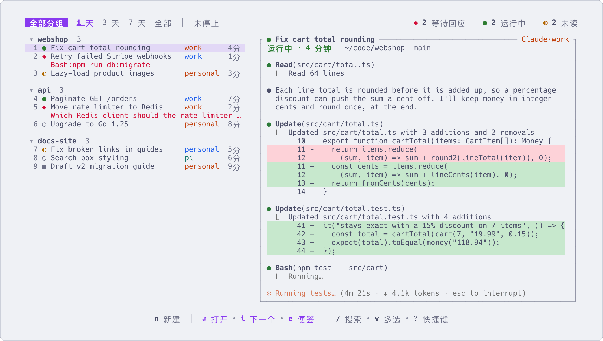

# 同时盯很多会话

[English](many-sessions.md) | 简体中文

同时跑五个 agent 时,难的是知道此刻哪个在等你。这一页讲 aca 怎样告诉你、怎样一个键就到那个会话,
以及你在看别处时怎样收到提醒。



## 看懂标记

每个会话前面的标记说明它需要你做什么。顶栏统计列表里这些会话的数量,例如 `◆ 1 等待回应    ● 1 运行中    ◐ 1 未读`。

| 标记 | 含义 | 你该做什么 |
|---|---|---|
| `◆` | 等待回应:有问题或权限请求。问题显示在这一行下面 | 回答它:进去回答,或者按 `s` 在列表里直接回答。你不回答,agent 就一直停着 |
| `◐` | 未读:它完成了一轮,你还没看 | 看结果,告诉它下一步 |
| `●` | 运行中 | 不用管 |
| `○` | 空闲,而且你已经看过它最后的回复 | 不用管 |
| `✕` | 出错 | 进去看看 |
| `■` | 已停止 | 按 `回车` 重新启动,继续原来的对话 |
| `☾` | 自动停止:空闲太久,被 aca 停掉了(见[下文](#停掉空闲的会话)) | 同样按 `回车` 继续 |

标题后面还可能有 `✎`(有便签)和 `◷ 12:27`(有到时间才发给它的消息或定时任务)。

## 去下一个待处理的会话

| 按键 | 作用 |
|---|---|
| `i` | 进入下一个待处理的会话:先 `◆` 后 `◐`,同一类里最近有动静的在前。按 `Ctrl+Q` 回来再按 `i`,就是下一个。看过之后没有新输出的会跳过 |
| `Ctrl+Alt+N` | 在会话里按:不经过列表,直接进入下一个待处理的会话,先 `◆` 后 `◐` |
| `空格` | 屏上每个会话显示一个字母,按哪个就进入哪个会话。每个分组还有一个自己的大写字母,写在左栏它的名字前面(屏幕没有左栏时写在它的标题上):`Shift` 加这个字母直接进那个分组,停在上次离开它的那一行。列表里列什么都不影响分组的字母。`空格` 或 `Esc` 取消 |
| `a` | 在分组里或左栏上按:回到全部分组,同时显示这些字母。再按 `a` 回到刚才的分组和那一行 |
| `u` | 在 `◐` 上按:标为已读。在 `○` 上按:重新标为未读 |

`Ctrl+Alt+N` 只在 aca 启动的会话里有效,在其他地方这个键照常发给里面的程序。用命令就是 `aca next`。
想换一个键:`aca tmux key next M-n`(键名用 tmux 的写法)。

## 分组整理

每个项目放一个分组。新建的会话会进入当时选中的会话所在的分组。

| 按键 | 作用 |
|---|---|
| `m` | 移到另一个分组。输入一个不存在的名字,就在会话所在的分组下面新建这个分组,并带上自己的目录(`Tab` 先修改目录;`/名字` 建在最上层) |
| `Ctrl+N` | 新建分组:起名、选目录,在里面建第一个会话 |
| `J` `K` | 下一个 / 上一个分组 |
| `W` | 进入高亮会话所在的分组,再按 `W` 回到全部分组 |
| `p` | 置顶:放进最上面单独的「★ 置顶」一块。再按 `p` 取消 |
| `h` | 光标到左栏:一个分组一行,后面写着组里 `◆` `◐` `✕` `●` 各几个和会话数。`j` `k` 换一个分组,列表跟着换;`回车` 进入。屏幕不到 130 列时平时没有左栏:按 `h` 叫出来盖在左边,`Esc` 收起 |

在命令行里,`aca new claude . -g work` 在分组 `work` 里新建会话(没有就创建),`aca move <id> work` 把会话移过去。

## 让一个会话替你分发

一个分组里会话多了,可以让其中一个专门分发,它叫这个分组的 router:你对它说一句,它交给合适的会话,没有合适的就新建一个;
你提到别的分组里相关的会话,它会拉过来。由你开头的这一轮,router 转交请求时,aca 会把你的原话捎给每个做活的会话一次。原话超过 1500 字时保留开头并标出总字数。做法由拿到交代的会话决定。

| 按键 | 作用 |
|---|---|
| `o` | 在分组的行上(左栏那一行,或它的标题):打开它的 router。还没有就打开新建框,目录照这个分组的。按 `↑` 选 Claude 或 Codex 的工具和账号,`回车` 启动。绑定 SSH 沙箱的 Claude 账号不可选。在会话的行上:这个会话所在分组的 router |
| `s` | 在分组的行上:回 router 一句,不用进去 |
| `` ` `` | 光标到左栏、亮出分组的字母,按哪个停到哪个分组那一行,右边就是和它的 router 的往来;再按 `o` 或 `s` |

有 router 的分组,名字前面有 `@`,颜色是 router 的状态。光标在这个分组上时,右边是和它的往来:你说的、它回的、它交给了谁、
拉来了哪些会话。做活会话的回复首行、问题、错误和任务完成的结果也显示在这里。上次看过之后新来的是粗体。

Claude router 用 aca 给的分发工具,也能用选择题问你。它没有 Bash,不读项目的 CLAUDE.md 和记忆,分发规矩在项目 router 或总台的角色文件里。
闲满 `[router] idle`(默认一小时),界面检查时会停,投递来话时也会检查是否该换班。等你回答或有人连着时不停。
灰色 `@` 表示停着。在分组行上按 `s` 发话就能叫醒它,也可按 `o` 打开。每次启动都是新对话,会话 id 不变。
第一句话是 aca 写的交接,带上当前任务单、会话、最近往来和待送的话。

Codex router 的规矩仍在开场话里。它不因空闲自动停,停着时来话排队或暂存,按 `o` 启动后继续原对话。

把已有的会话设成 router:`aca group router <分组> <id>`;取消:`aca group router <分组> ''`。

不属于哪个项目的事有一个固定的去处:在 `Ctrl+S` 里按 `s` 设置随手问目录,在那个目录工作的分组排在「全部」下面,
光标不在哪个项目上时新建的会话进这个分组。它的名字前面有 `⌂`,它下面的分组写成 `⌂/名字`。这个分组的 router 就是总台:不知道该交给谁的事交给它,它交给合适的会话
或项目的 router。Claude 总台遇到不属于哪个项目的活,会在随手问分组开单。它的 `@` 在左栏「全部」那一行前面;在那一行上按 `o`、`s` 就是打开它、回它一句
(还没有总台时 `o` 新建一个,没设置随手问目录就先问目录)。

## 只看要紧的

| 按键 | 作用 |
|---|---|
| `/` | 按文字搜索,高亮落在匹配的会话里最近有动静的那条(先看未停止的)。`Esc` 清空 |
| `F` | 按状态筛选:列出各种状态和数量。其中 `2` 是 `◆` 和 `◐` 一起,`☾` 自动停止是 `■` 已停止的一部分 |
| `F` 再按 `1`–`6` | 直接挑一种:运行中、等待回应 / 未读、空闲、出错、已停止、自动停止 |
| `0` | 所有会话,不管停了多久(`F` 再按 `0` 也是)。再按 `0` 或 `Esc` 回去 |
| `w` | 在未停止的会话(默认)和近 7 天(含已停止的)之间切换 |

## 给自己留张便签

看到某个会话需要什么、但现在顾不上时,先记下来。

| 按键 | 作用 |
|---|---|
| `e` | 写便签:准备对它说的下一句话。输入时自动保存,`Esc` 写完。这一行会显示 `✎` |
| `E` | 带着便签进入:便签填进它的输入框、不发送,你可以先改改 |
| `s` | 回话:不进入,直接回它一句。便签已经填在框里,`Enter` 发送,`Ctrl+J` 换行,`Esc` 留作便签。发出后便签删除 |

在分组上按 `e`,写的是这个分组的一条笔记,记整体的想法(进分组后按 `Tab` 看全部笔记),不会发给任何会话。

要交给会话做的事可以记成任务单:进分组后 `Tab` 到任务页,`n` 新建(名字和完成标准),`m` 交给组里的一个会话,它会收到这张单;
它做完后自己运行 `aca task done`,或者你按 `c`。有没完成的任务单的分组,进去先看到任务页。新建的待交单会通知分组 router,先做哪张由它决定。

想跟进哪张单就告诉 router 盯着它。盯着的单,会话一轮结束、等回答、出错、退出或标成完成时,分组 router 会收到通知,没有 router 就通知交单的会话。
会话有问题时,router 把问题交给你回答。没盯的单,结果直接进往来,不用叫醒 router 转述。如果同组还有待交单,完成时仍会通知它来派下一张。
命令行开关见 `aca help task`。

## 在别处时收到提醒

自带的 `aca.notify` 插件会在会话完成一轮、开始等待回应或出错时弹出桌面通知。你正在看的那个会话不提醒。
它需要 `jq`。

```sh
aca plugin install aca.notify         # 或者按 P,在「可安装」里选它
aca plugin run aca.notify.test        # 弹一条测试通知
aca plugin setting aca.notify workers true    # 其他 agent 派出的会话也提醒
```

另外两个设置:`attached`(你正在看的会话也提醒)和 `command`(用你自己的脚本显示通知)。
`aca.bark` 和 `aca.discord` 把同样的提醒发到手机或 Discord 频道,见[第一方插件](plugins.zh-CN.md#第一方插件)。

## 在 tmux 里盯着

```sh
aca tmux install
```

它在你的 `tmux.conf` 里加两行(`aca tmux uninstall` 移除),带来:

- **tmux 状态栏上的数量**,形如 ` ◆ 2  ◐ 3`:几个在等待回应、几个未读。
- **`Ctrl+\`**:在任何 tmux 会话里按,aca 在右侧打开作为切换器,旁边的窗格跟着高亮切换会话。
  `回车` 留在那个会话,`Esc` 回到原来的地方,再按 `Ctrl+\` 关闭。窗口不足 120 列时全屏打开。
- **前缀键,再按 `a`**:全屏打开 aca。

## 停掉空闲的会话

空闲的 agent 也会一直占用 CPU。在 `~/.config/aca/config.toml` 里加上:

```toml
[idle]
stop_after = "3h"       # 空闲超过这么久就停止,显示 ☾
remove_after = "30d"    # 停止超过这么久就删除(移到回收站)
```

界面开着时,aca 每 5 分钟检查一次。对普通会话,这一轮还没结束、在等待回应、未读、有人连接着、输入框里有没发出的内容、
有定时任务的会话都不会停(完整的条件见 `aca help stop`)。在 `☾` 的会话上按 `回车` 可以重启。Claude router 单独按自己的时限判闲,启动时从交接开始。
删除的会话在回收站保留 1 天(按 `b`,或者马上按 `Ctrl+Z`);置顶的、有便签的不会删除。
`aca stop --idle 3h` 是手动执行一次同样的操作。

## 更多

- [按键](keys.zh-CN.md):列表里的每一个键
- [配置](configuration.zh-CN.md):`[idle]`、`[keys]` 以及 `config.toml` 的其他内容
- [插件](plugins.zh-CN.md):提醒类插件,以及插件还能做什么
- `aca help keys`、`aca help next`、`aca help tmux`、`aca help stop`
