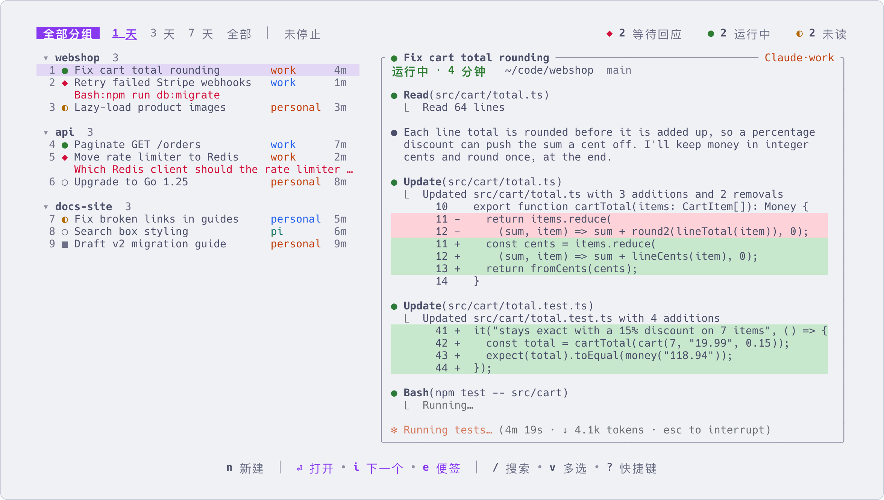

# 同时盯很多会话

[English](many-sessions.md) | 简体中文

同时跑五个 agent 时,难的是知道此刻哪个在等你。这一页讲 aca 怎样告诉你、怎样一个键就到那个会话,
以及你在看别处时怎样收到提醒。



## 看懂标记

每个会话前面的标记说明它需要你做什么。顶栏统计屏幕上这些会话的数量,例如 `◆ 1 等待回应    ● 1 运行中    ◐ 1 未读`。

| 标记 | 含义 | 你该做什么 |
|---|---|---|
| `◆` | 等待回应:有问题或权限请求。问题显示在这一行下面 | 回答它。你不回答,agent 就一直停着 |
| `◐` | 未读:它完成了一轮,你还没看 | 看结果,告诉它下一步 |
| `●` | 运行中 | 不用管 |
| `○` | 空闲,而且你已经看过它最后的回复 | 不用管 |
| `✕` | 出错 | 进去看看 |
| `■` | 已停止 | 按 `回车` 重新启动,继续原来的对话 |
| `☾` | 自动停止:空闲太久,被 aca 停掉了(见[下文](#停掉空闲的会话)) | 同样按 `回车` 继续 |

标题后面还可能有 `✎`(有便签)和 `◷ 12:27`(有到时间才发给它的消息或定时任务)。

## 去下一个待处理的会话

| 按键 | 作用 |
|---|---|
| `i` | 进入最近一个待处理的会话(`◆` 或 `◐`)。按 `Ctrl+Q` 回来再按 `i`,就是下一个。看过之后没有新输出的会跳过 |
| `Ctrl+Alt+N` | 在会话里按:不经过列表,直接进入下一个待处理的会话,先 `◆` 后 `◐` |
| `空格` | 每一行显示一个字母,按哪个就进入哪个会话(在分组上则是高亮移到那个分组)。`Esc` 取消 |
| `u` | 在 `◐` 上按:标为已读。在 `○` 上按:重新标为未读 |

`Ctrl+Alt+N` 只在 aca 启动的会话里有效,在其他地方这个键照常发给里面的程序。用命令就是 `aca next`。
想换一个键:`aca tmux key next M-n`(键名用 tmux 的写法)。

## 分组整理

每个项目放一个分组。新建的会话会进入当时选中的会话所在的分组。

| 按键 | 作用 |
|---|---|
| `m` | 移到另一个分组。输入一个不存在的名字,就新建这个分组 |
| `Ctrl+N` | 新建分组:起名、选目录,在里面建第一个会话 |
| `Tab` | 分组列表。按分组前面的字母只看那一组,按 `空格` 看全部 |
| `{` `}` | 上一个 / 下一个分组 |
| `W` | 只看高亮会话所在的分组,再按 `W` 回到全部 |
| `p` | 置顶:放进最上面单独的「★ 置顶」一块。再按 `p` 取消 |
| `o` / `O` | 折叠或展开当前分组 / 全部分组。折叠后只剩一行,里面有等待回应的会标 `◆` |

在命令行里,`aca new claude . -g work` 在分组 `work` 里新建会话(没有就创建),`aca move <id> work` 把会话移过去。

## 只看要紧的

| 按键 | 作用 |
|---|---|
| `/` | 按文字搜索。`Esc` 清空 |
| `F` | 按状态筛选:列出各种状态和数量。其中 `@` 是 `◆` 和 `◐` 一起 |
| `!` `@` `#` `&` `^` `%` | 在列表里直接按,效果同上:运行中、等待回应 / 未读、空闲、出错、已停止、自动停止。再按一次取消 |
| `w` | 只看未停止的会话(已停止以外的都算)。再按 `w` 回去 |
| `*` / `a` | 近几天:1 天、3 天或 7 天 / 全部 |

## 给自己留张便签

看到某个会话需要什么、但现在顾不上时,先记下来。

| 按键 | 作用 |
|---|---|
| `e` | 写便签:准备对它说的下一句话。输入时自动保存,`Esc` 写完。这一行会显示 `✎` |
| `E` | 带着便签进入:便签填进它的输入框、不发送,你可以先改改 |
| `s` | 不进入,直接把便签发给它(先确认,按 `y` 发送)。发出后便签删除 |

在分组上按 `e`,写的是这个分组自己的便签,记整体的想法,不会发给任何会话。

## 在别处时收到提醒

自带的 `aca.notify` 插件会在会话完成一轮、开始等待回应或出错时弹出桌面通知。你正在看的那个会话不提醒。
它需要 `jq`。

```sh
aca plugin install aca.notify         # 或者按 P,在「可安装」里选它
aca plugin run aca.notify.test        # 弹一条测试通知
aca plugin setting aca.notify workers true    # 其他 agent 派出的会话也提醒
```

另外两个设置:`attached`(你正在看的会话也提醒)和 `command`(用你自己的脚本显示通知)。
`aca.bark` 和 `aca.discord` 把同样的提醒发到手机或 Discord 频道,见[第一方插件](plugins.zh-CN.md#第一方插件)。

## 在 tmux 里盯着

```sh
aca tmux install
```

它在你的 `tmux.conf` 里加两行(`aca tmux uninstall` 移除),带来:

- **tmux 状态栏上的数量**,形如 ` ◆ 2  ◐ 3`:几个在等待回应、几个未读。
- **`Ctrl+\`**:在任何 tmux 会话里按,aca 在右侧打开作为切换器,旁边的窗格跟着高亮切换会话。
  `回车` 留在那个会话,`Esc` 回到原来的地方,再按 `Ctrl+\` 关闭。窗口不足 120 列时全屏打开。
- **前缀键,再按 `a`**:全屏打开 aca。

## 停掉空闲的会话

空闲的 agent 也会一直占用 CPU。在 `~/.config/aca/config.toml` 里加上:

```toml
[idle]
stop_after = "3h"       # 空闲超过这么久就停止,显示 ☾
remove_after = "30d"    # 停止超过这么久就删除(移到回收站)
```

界面开着时,aca 每 5 分钟检查一次。这一轮还没结束、在等待回应、未读、有人连接着、输入框里有没发出的内容、
有定时任务的会话都不会停(完整的条件见 `aca help stop`)。在 `☾` 的会话上按 `回车`,会继续原来的对话。
删除的会话在回收站保留 1 天(按 `b`,或者马上按 `Ctrl+Z`);置顶的、有便签的不会删除。
`aca stop --idle 3h` 是手动执行一次同样的操作。

## 更多

- [按键](keys.zh-CN.md):列表里的每一个键
- [配置](configuration.zh-CN.md):`[idle]`、`[keys]` 以及 `config.toml` 的其他内容
- [插件](plugins.zh-CN.md):提醒类插件,以及插件还能做什么
- `aca help keys`、`aca help next`、`aca help tmux`、`aca help stop`
