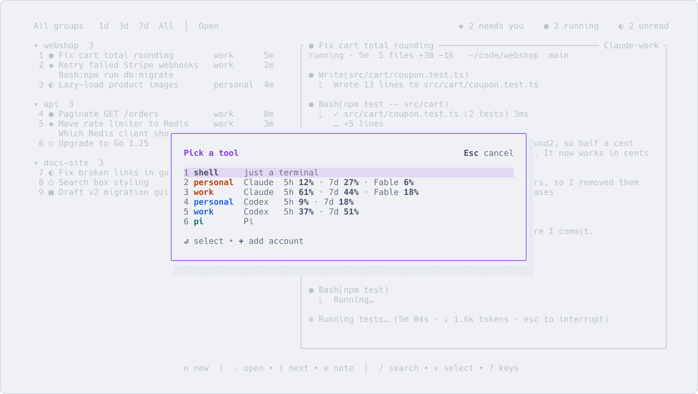

# Several accounts, and running out of quota

English | [简体中文](several-accounts.zh-CN.md)

If you have more than one subscription, say a personal one and a work one, sessions from all of them sit in
one list. When one account runs out in the middle of a task, you carry the same conversation on under
another one instead of starting over. Registering accounts is covered in [Accounts](accounts.md); this
page is about using them.

## Start a session under a given account

Press `n`. The menu lists a plain shell first, then your accounts by name (Claude first, then Codex), each
with its tool and how much of its quota is used, then tools you defined yourself. Press the number in
front of the one you want, then confirm the directory.



| Key | What it does |
|---|---|
| `n` | New session: pick the tool and account, then the directory. `+` in the menu adds an account |
| `N` | New with the current settings: the same tool, account and directory as the selected session. Change the directory if you like, `Enter` creates it |

On the command line, write the account after a colon:

```sh
aca new claude:work ~/code/app
aca names                  # every tool and tool:account name you can use
```

With no account named, the tool uses its own default directory and login. To make one account the
default for a tool, set `account = "work"` under `[tools.claude]` in `config.toml`.

## See which accounts are logged in, and how much is used

| Where | What you get |
|---|---|
| `aca account status` | Each account, logged in or not (asked from the tool itself), and the command to log in if not |
| `Ctrl+S`, then `a` | The accounts page: login state, quota, launch arguments, which sessions use each one. `Enter` logs in, `r` checks again |
| The `n` menu and the `X` box | How much of the quota is used, next to each account |
| `$` | Every account's quota at the top of the billing page; see [Usage, cost and limits](usage-and-cost.md) |

Quotas read like `5h 7% · 7d 1%`: the share of the 5-hour and the 7-day allowance used. They turn amber past
70% and red past 90%. Codex reports them by itself. Claude reports them only to its status bar, so to see
Claude's, connect the status bar as described in [Accounts](accounts.md). Accounts logged in with an API key
have no quota.

## When an account runs out: `X`

A session stopped by a quota or login error shows the error under its row, with `X switch account` next to
it. Press `X` on it (or on any Claude or Codex session):

1. The box shows the current account and its quota, then the accounts of the same tool it can move to:
   logged in or not, and how much of their quota is used.
2. Press `Enter` or a number to switch. An account that is not logged in can't be picked: `a` opens the
   accounts page to log in, `+` adds an account. Then press `X` again.

The session restarts in place under the new account and resumes the same conversation. Its record is
copied into the new account's directory, so the whole context comes along, and the row, title and note
stay as they were. If the session is running or waiting for you, the box warns that switching interrupts
the turn. The first turn afterwards costs more than usual: the new account has nothing cached yet, so the
whole context is written to its cache again.

The same from the command line:

```sh
aca restart 3f2a --as work
```

This only works between accounts of the same tool. To move a Claude conversation to Codex, or the other way,
hand it off.

## Hand off to another tool or account: `H`

`H` starts a new session that picks up where this one is. Pick its tool and account (the `n` menu without
the shell). It is created in the same directory and group, and is sent a handoff note: the conversation
record, a text version of it (what both sides said, subagent reports, the files changed), the directory, the
conversation id, and your note on the session. It reads all that and carries on, asking you first only if
the original ended on a question that your note doesn't answer. The original is left as it is.

## Fork: `f`

`f` opens a new session that continues from this conversation, with the same tool, account and group.
Name it in the popup (it suggests "<title> (fork)") and press `Enter`. Both now go their own way; the new
row says which session it was forked from. Use it to try a second approach without losing the first.
It needs a Claude or Codex session that has already talked.

```sh
aca fork 3f2a -t "try another approach"
```

## Which one to use

| | The new session has | Another tool | The original |
|---|---|---|---|
| `X` | (no new session) | No | Restarts under the other account, same conversation, same row |
| `H` | A handoff note about the conversation | Yes | Left alone |
| `f` | A copy of the conversation | No | Left alone |

## More

- [Accounts](accounts.md): registering accounts, logging in, Claude's status bar
- [Keys](keys.md): `n`, `N`, `X`, `H`, `f` and the accounts page in detail
- [Everyday commands](commands.md): `aca new`, `aca restart`, `aca fork`, `aca account`
- `aca help account`, `aca help restart`
