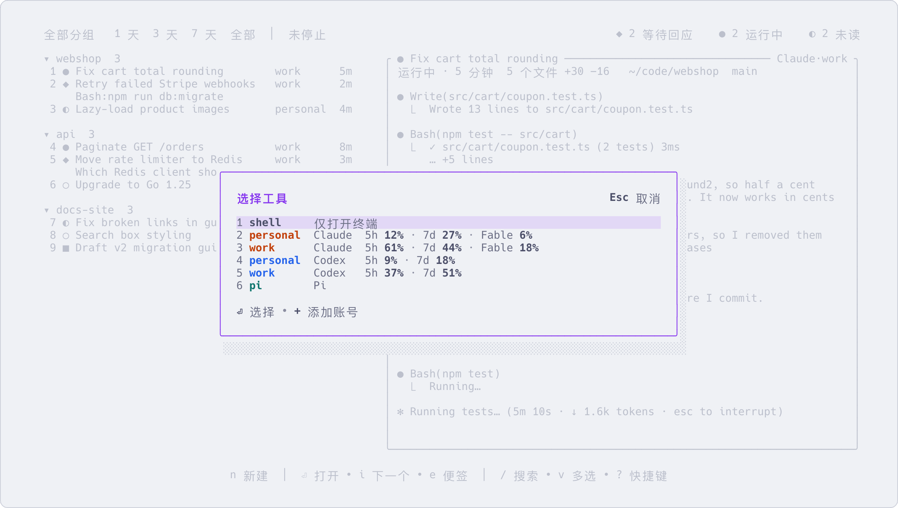

# 多个账号,额度用完了怎么办

[English](several-accounts.md) | 简体中文

如果你有不止一个订阅,比如一个个人的、一个公司的,所有账号的会话都在同一个列表里。
一个账号在任务做到一半时额度用完了,可以换一个账号继续同一段对话,不用从头再来。
怎样登记账号见[账号](accounts.zh-CN.md);这一页讲登记之后怎么用。

## 用指定的账号新建会话

按 `n`。菜单最上面是 shell,然后按名字列出你的账号(先 Claude 后 Codex),每个账号后面是所属工具和额度用了多少,
最后是你自己定义的工具。按前面的数字选择,再确认目录。



| 按键 | 作用 |
|---|---|
| `n` | 新建:先选工具和账号,再填目录。在菜单里按 `+` 添加账号 |
| `N` | 按当前配置新建:沿用选中会话的工具、账号和目录。目录可以改,按 `回车` 新建 |

在命令行里,账号写在冒号后面:

```sh
aca new claude:work ~/code/app
aca names                  # 列出能用的工具名和「工具:账号」
```

不写账号时,工具使用它自己默认的目录和登录。想给某个工具固定一个默认账号,在 `config.toml` 的
`[tools.claude]` 下写 `account = "work"`。

## 查看哪些账号已登录、额度用了多少

| 在哪里看 | 能看到什么 |
|---|---|
| `aca account status` | 每个账号是否已登录(向工具本身查询),没登录的还会给出登录命令 |
| `Ctrl+S`,再按 `a` | 账号页:登录状态、额度、启动参数、哪些会话在用。`回车` 登录,`r` 重新检查 |
| `n` 菜单和 `X` 的弹窗 | 每个账号后面写着额度用了多少 |
| `$` | 计费页顶部列出每个账号的额度,见[用量、花费和额度](usage-and-cost.zh-CN.md) |

额度写成 `5h 7% · 7d 1%` 这样:5 小时和 7 天的额度各用了多少。超过 70% 显示黄色,超过 90% 显示红色。
Codex 的额度它自己会记下来。Claude 只把额度提供给它的状态栏,所以想看 Claude 的额度,
要按[账号](accounts.zh-CN.md)里说的把状态栏接上。用 API key 登录的账号没有额度。

## 额度用完时:`X`

因为额度或登录问题停下的会话,列表那一行下面会显示原始的错误,旁边是 `X 换账号`。
在它上面(或者任何一个 Claude、Codex 会话上)按 `X`:

1. 弹窗顶部是当前账号和它的额度,下面是同一工具里可以切换过去的账号:是否已登录、额度用了多少。
2. 按 `回车` 或数字切换。没登录的账号不能选:按 `a` 去账号页登录,按 `+` 添加账号,然后再按一次 `X`。

会话在原处换成新账号重启,继续同一段对话。它的对话记录会复制到新账号的配置目录,所以上下文完整保留,
列表里那一行、标题和便签都不变。会话正在运行或等待回应时,弹窗会提示切换将中断这一轮。
切换后的第一轮比平时贵:新账号还没有缓存,整段上下文要重新写入一遍缓存。

用命令也可以:

```sh
aca restart 3f2a --as work
```

只能在同一个工具的账号之间切换。想把 Claude 的对话交给 Codex(或者反过来),用交接。

## 交接给别的工具或账号:`H`

`H` 新建一个会话,接手这个会话的工作。先选择新会话的工具和账号(同 `n` 的菜单,没有 shell)。
新会话建在原会话的目录和分组里,并收到一份交接说明:对话记录、整理好的文字版(双方的发言、子代理的报告、
修改过的文件)、目录、对话 id,以及你在原会话上写的便签。它读完后自行接着做;只有原会话最后在向你提问、
便签里又没有回答时,才会先问你。原会话保持不变。

## 分叉:`f`

`f` 新开一个会话,从当前这段对话继续,工具、账号和分组都和原会话相同。先在弹窗里起名(已预填
「原标题 (分叉)」),按 `回车`。之后两个会话各走各的;新的那一行会写着它是从哪个会话分出来的。
适合在不丢掉第一种做法的前提下试第二种。只有已经对话过的 Claude、Codex 会话才能分叉。

```sh
aca fork 3f2a -t "试试另一个方案"
```

## 该用哪一个

| | 新会话里有什么 | 能换工具 | 原会话 |
|---|---|---|---|
| `X` | (不新建会话) | 不能 | 换成另一个账号重启,还是同一段对话、同一行 |
| `H` | 一份关于这段对话的交接说明 | 能 | 不变 |
| `f` | 这段对话的一份副本 | 不能 | 不变 |

## 更多

- [账号](accounts.zh-CN.md):登记账号、登录、Claude 的状态栏
- [按键](keys.zh-CN.md):`n`、`N`、`X`、`H`、`f` 和账号页的详细说明
- [常用命令](commands.zh-CN.md):`aca new`、`aca restart`、`aca fork`、`aca account`
- `aca help account`、`aca help restart`
