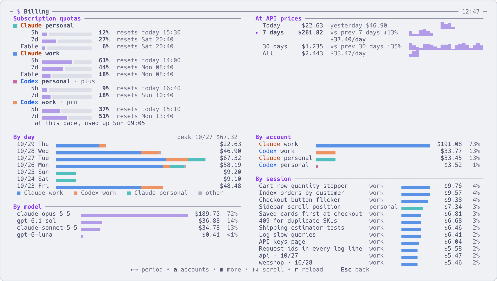

# Usage, cost and limits

English | [简体中文](usage-and-cost.zh-CN.md)

Two questions come up once you run agents all day: how much would this cost at API prices, and how close
am I to my subscription limits. The `$` page answers both, from files already on your computer.



## Open it

| | |
|---|---|
| `$` in the interface | The billing page. `Esc`, `q` or `$` closes it |
| `aca cost` | The same report in the terminal, for the last 7 days |
| `aca cost 1`, `aca cost 30`, `aca cost all` | Today, the last 30 days, everything |
| `aca cost --only work,personal` | Only these accounts, by the names aca shows (`work`, not `claude:work`) |

## What the numbers mean

- **Every Claude Code and Codex call made on this computer**, priced in dollars at the official API prices.
  That includes subscription accounts: for them it is what the same usage would have cost through the API,
  not what you paid.
- It reads the agents' own conversation records in each registered account's configuration directory and in
  `~/.claude` and `~/.codex`. Nothing goes over the network. A call recorded more than once counts once.
- Models missing from aca's price list are shown in tokens, without a price.
- Only Claude Code and Codex are counted.

## Reading the page

| Block | What it shows |
|---|---|
| Subscription quotas | For each account, how much of each window is used (`5h`, `7d`, and per-model weekly limits where there are any) and when it resets. It says "reset" once the reset time has passed with no newer reading |
| At API prices | The cost for today, 7 days, 30 days and all. Next to them: yesterday's cost, whether the last 7 and 30 days went up or down against the 7 and 30 days before, and the daily average |
| By hour / day / month | The selected period over time: today by hour, all by month, the others by day |
| By account, By model, By session | Where the money went. Each appears once there are at least two rows |

`m` shows more: Usage (number of calls, tokens, the cache hit rate and what the cache saved, the split between
input, cache writes, cache reads and output), By weekday and hour, and By directory.

| Key | What it does |
|---|---|
| `←` `→`, `Tab`, `1`–`4` | Change the period |
| `↑` `↓` | Scroll |
| `a` | Pick which accounts to show: `Enter` or a number shows only that one, `Space` ticks several, `0` all |
| `m` | More / less |
| `r` | Read the records again |
| `Esc` | Back to the list |

Opening the page reads all the records, which takes a second or two. While it is open it reads them again
every 5 minutes.

## Subscription limits

- **Codex** writes its limits into its own conversation records, and aca reads them from there. Nothing to
  set up.
- **Claude Code** reports its limits only to its status bar command, so the status bar has to go through aca:
  run `aca setup`, pick how to connect each Claude account, and press `Enter`. What the choices mean and what
  gets changed is in [Accounts](accounts.md). Without it everything else works; the page just has no Claude
  limits at the top.
- Per-model weekly limits never reach the status bar. For registered Claude accounts with sessions in use,
  aca asks Claude itself in the background every few minutes and adds them.
- Accounts logged in with an API key have no subscription limits.

The same numbers appear next to each account in the `n` menu, in the `X` box and on the accounts page
(`Ctrl+S`, then `a`). They turn amber past 70% and red past 90%. When one runs out, see
[Several accounts](several-accounts.md).

## For scripts

```sh
aca limits --json      # every account's quotas right now, as one JSON object
aca events -f          # includes a limits.changed line whenever the numbers move
```

## More

- [Accounts](accounts.md): connecting Claude's status bar, and where the limits come from
- [Everyday commands](commands.md): `aca cost` and `aca limits`
- [Several accounts, and running out of quota](several-accounts.md)
- `aca help cost`, `aca help limits`
