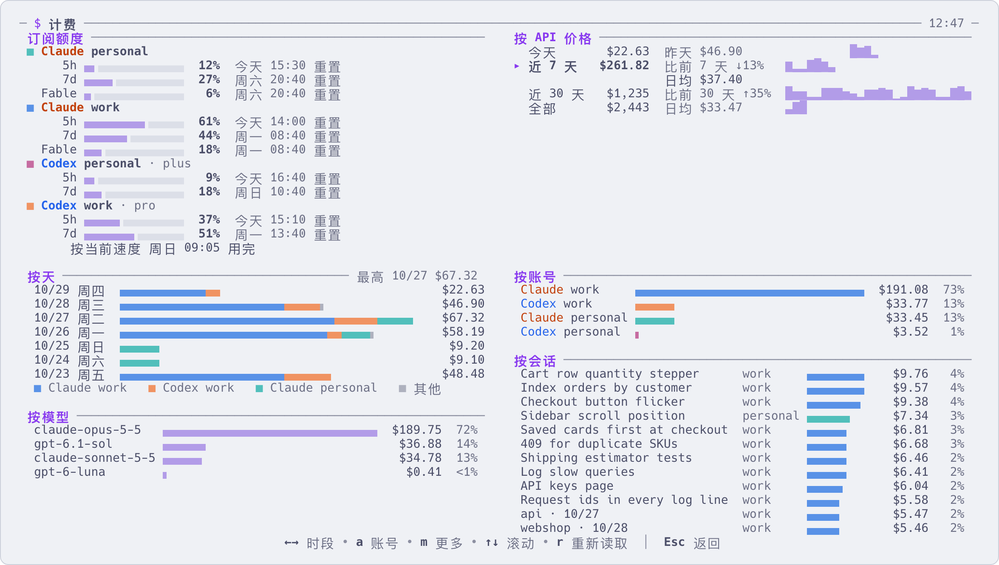

# 用量、花费和额度

[English](usage-and-cost.md) | 简体中文

整天跑 agent,迟早会想知道两件事:按 API 价格算要花多少钱,订阅额度还剩多少。`$` 页面同时回答这两个问题,
用的都是你电脑上已有的文件。



## 打开

| | |
|---|---|
| 界面里按 `$` | 计费页。按 `Esc`、`q` 或 `$` 关闭 |
| `aca cost` | 在终端里打印同样的内容,默认是近 7 天 |
| `aca cost 1`、`aca cost 30`、`aca cost all` | 今天、近 30 天、全部 |
| `aca cost --only work,personal` | 只看这几个账号,写 aca 显示的账号名(`work`,不是 `claude:work`) |

## 这些数字是什么意思

- **这台电脑上 Claude Code 和 Codex 的每一次调用**,按官方 API 价格折算成美元。订阅账号也照样计算:
  算的是这些用量如果通过 API 购买要花多少钱,不是你实际付了多少。
- 读取的是 agent 自己的对话记录:每个登记过的账号的配置目录,以及 `~/.claude` 和 `~/.codex`。不联网。
  同一次调用被记录了多次的,只算一次。
- aca 价目表里没有的模型只列 token 数,不计价。
- 只统计 Claude Code 和 Codex。

## 看懂这一页

| 区块 | 显示什么 |
|---|---|
| 订阅额度 | 每个账号各个窗口用了多少(`5h`、`7d`,有的还有按模型分的周额度)、什么时候重置。已过重置时间但还没有新数据的显示「已重置」 |
| 按 API 价格 | 今天、近 7 天、近 30 天、全部的花费。旁边是:昨天花了多少,近 7 天和近 30 天比之前的 7 天、30 天是涨是跌,以及日均 |
| 按小时 / 按天 / 按月 | 选中的时段随时间的变化:今天按小时,全部按月,其余按天 |
| 按账号、按模型、按会话 | 钱花在了哪里。至少有两行时才显示 |

按 `m` 显示更多:用量(调用次数、token、缓存命中率和缓存省下的钱,输入、缓存写入、缓存读取、输出各占多少)、
按星期和钟点、按目录。

| 按键 | 作用 |
|---|---|
| `←` `→`、`Tab`、`1`–`4` | 切换时段 |
| `↑` `↓` | 滚动 |
| `a` | 选择看哪些账号:`回车` 或数字只看那一个,`空格` 勾选多个,`0` 全部 |
| `m` | 显示更多 / 收起 |
| `r` | 重新读取记录 |
| `Esc` | 回到列表 |

打开这一页时会读取全部记录,要一两秒。开着的时候每 5 分钟重新读取一次。

## 订阅额度

- **Codex** 把额度写在它自己的对话记录里,aca 从那里读取。不需要设置。
- **Claude Code** 只把额度提供给它的状态栏命令,所以状态栏得经过 aca:运行 `aca setup`,为每个 Claude 账号
  选择连接方式,按 `回车`。各个选项的含义以及会改动什么,见[账号](accounts.zh-CN.md)。不接也不影响其他功能,
  只是这一页顶部没有 Claude 的额度。
- 按模型分的周额度状态栏拿不到。对有会话在用的、登记过的 Claude 账号,aca 每隔几分钟在后台向 Claude 查询一次补上。
- 用 API key 登录的账号没有订阅额度。

同样的数字也显示在 `n` 菜单、`X` 的弹窗和账号页(`Ctrl+S` 再按 `a`)里每个账号的旁边。
超过 70% 显示黄色,超过 90% 显示红色。额度用完了怎么办,见[多个账号](several-accounts.zh-CN.md)。

## 给脚本用

```sh
aca limits --json      # 每个账号此刻的额度,一个 JSON
aca events -f          # 数字变化时会有一行 limits.changed
```

## 更多

- [账号](accounts.zh-CN.md):接入 Claude 的状态栏,以及额度从哪里来
- [常用命令](commands.zh-CN.md):`aca cost` 和 `aca limits`
- [多个账号,额度用完了怎么办](several-accounts.zh-CN.md)
- `aca help cost`、`aca help limits`
